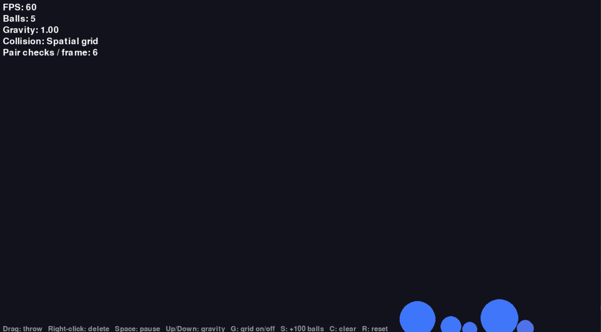

# Ball Physics Sim

A 2D ball physics simulation built in Python with pygame. You can throw balls with the mouse, watch them collide with realistic momentum, and stress test the engine with hundreds of balls. It uses a spatial grid to keep collision detection fast.



## Features

- **Momentum-based collisions:** balls bounce off each other using impulse physics along the collision normal, so angled hits and vertical stacking behave correctly.
- **Mass from size:** each ball's mass is calculated from its area (`density × πr²`), so bigger balls hit harder and get pushed around less.
- **Drag-to-throw:** click, pull back like a slingshot, and release to launch a ball. An aim line shows the launch direction.
- **Speed colouring:** balls shift from blue to red as they speed up, which makes energy transfer in collisions easy to see.
- **Spatial grid optimization:** collision checks only compare nearby balls instead of every pair. Toggle it live to compare.
- **Live HUD:** FPS, ball count, gravity, collision method, and the number of pair checks per frame.

## Controls

- **Left-click + drag:** throw a ball (slingshot style)
- **Right-click:** delete the ball under the cursor
- **Space:** pause / resume
- **Up / Down:** increase / decrease gravity
- **G:** toggle spatial grid vs. brute force collisions
- **S:** spawn 100 random balls (stress test)
- **C:** clear all balls
- **R:** reset

## Installation

Requires Python 3.10+.

```bash
git clone https://github.com/<your-username>/ball-physics-sim.git
cd ball-physics-sim
python -m venv venv
venv\Scripts\activate        # Windows
# source venv/bin/activate   # macOS / Linux
pip install pygame-ce
python ball_sim.py
```

> **Why pygame-ce?** The original `pygame` package has no prebuilt wheels for Python 3.14, so `pip install pygame` tries to compile from source and fails on Windows. `pygame-ce` (Community Edition) is an actively maintained fork that installs cleanly and is imported the same way (`import pygame`).

## How it works

### Collision response

When two balls overlap, the sim:

1. Finds the **collision normal**, the unit vector between the two centres.
2. **Pushes the balls apart** so they no longer overlap. The heavier ball moves less.
3. Calculates the **relative velocity along the normal**. If the balls are already moving apart, nothing else happens.
4. Applies an equal and opposite **impulse** to both balls, scaled by their masses and a restitution (bounciness) factor:

```
j = -(1 + e) · v_rel / (1/m₁ + 1/m₂)
v₁ -= (j / m₁) · n
v₂ += (j / m₂) · n
```

This conserves momentum and works at any angle. (An earlier version only exchanged x-velocities using the 1D elastic collision formula, which broke for vertical hits.)

### Spatial grid

Checking every pair of balls is O(n²). 300 balls means 44,850 pair checks every frame.

The spatial grid splits the screen into cells at least as wide as the largest ball. Each frame, every ball is placed in a cell, and each ball is only checked against balls in its own cell and the 8 neighbouring cells. Since two balls can only touch if they're within one cell of each other, no collisions are missed.

The pair checks per frame are shown in the HUD, so you can see the difference directly.

## Benchmarks

Measured on **Intel Core 7 150U** at 60 FPS target, by pressing S to add balls and G to toggle the collision method.

- **100 balls:** brute force 60 FPS, spatial grid 60 FPS
- **300 balls:** brute force 58 FPS, spatial grid 60 FPS
- **600 balls:** brute force 20 FPS, spatial grid 60 FPS

## What I learned

- Turning a 1D elastic collision formula into 2D vector-based impulse physics
- Why position correction and velocity response need to be handled separately
- How event handling in pygame works (and why calling `pygame.event.get()` twice silently drops input)
- Measuring and fixing an O(n²) bottleneck with spatial partitioning

## Possible next steps

- Frame-rate independent physics using delta time
- Physics sub-steps to stop fast balls from tunnelling through each other
- Static obstacles (Plinko-style pegs, angled ramps)
- Gravity between balls for orbital motion
- Settings panel with sliders for gravity and restitution

## Built with

- Python
- [pygame-ce](https://pyga.me/)